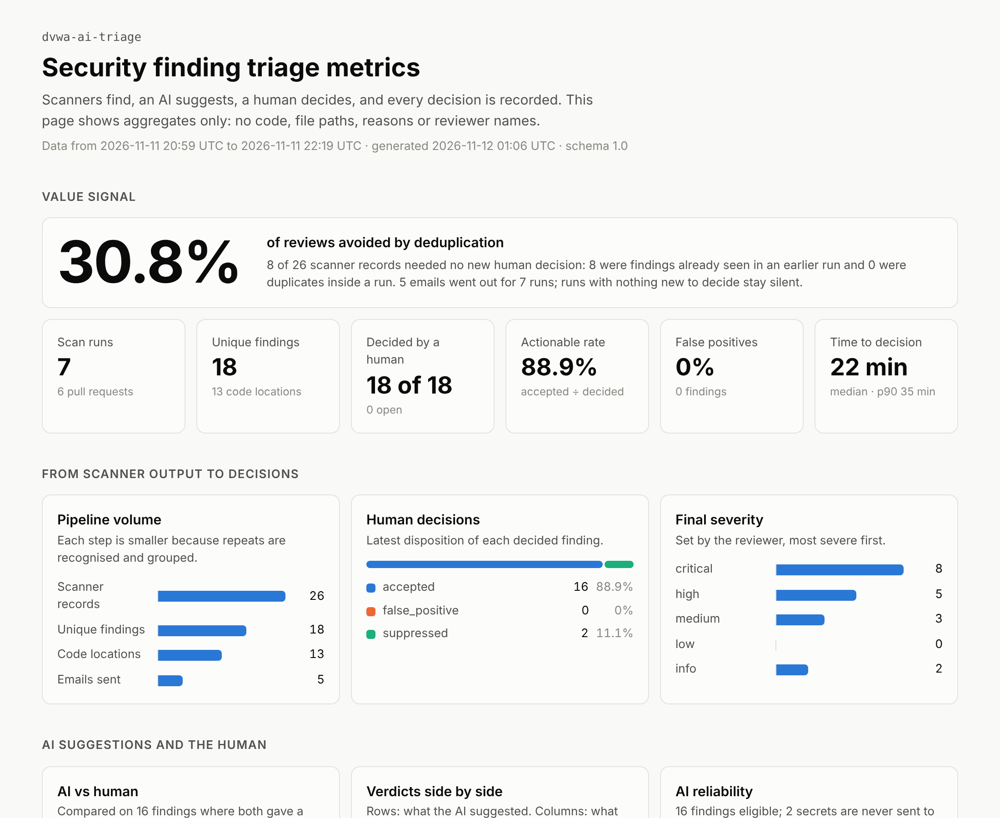
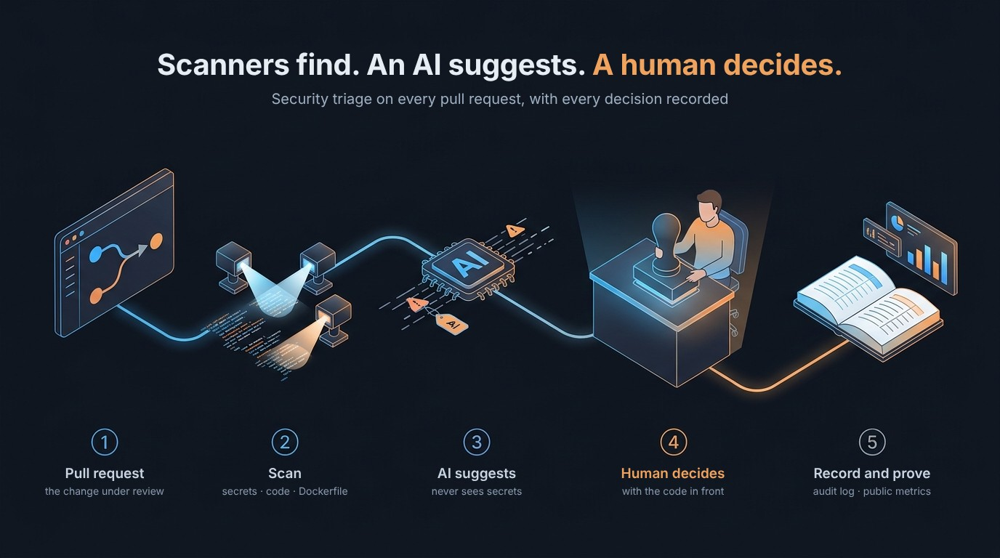
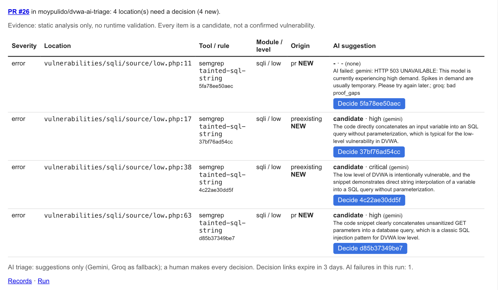
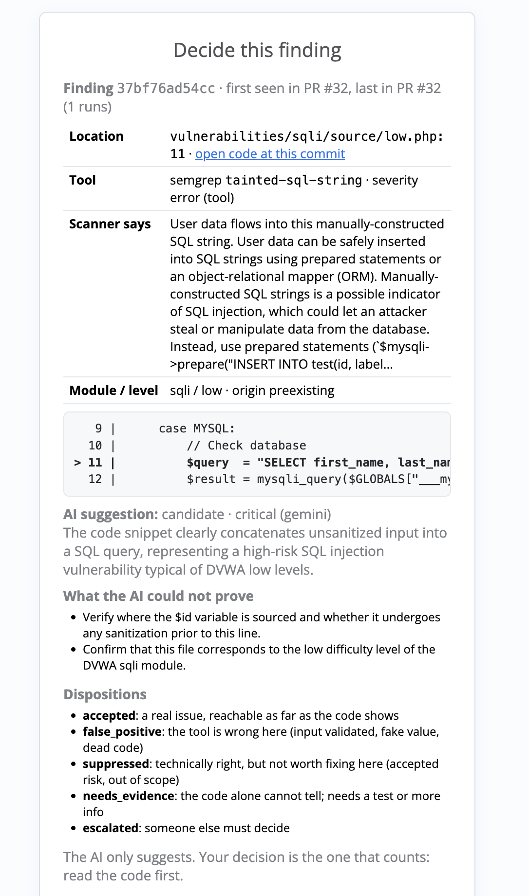
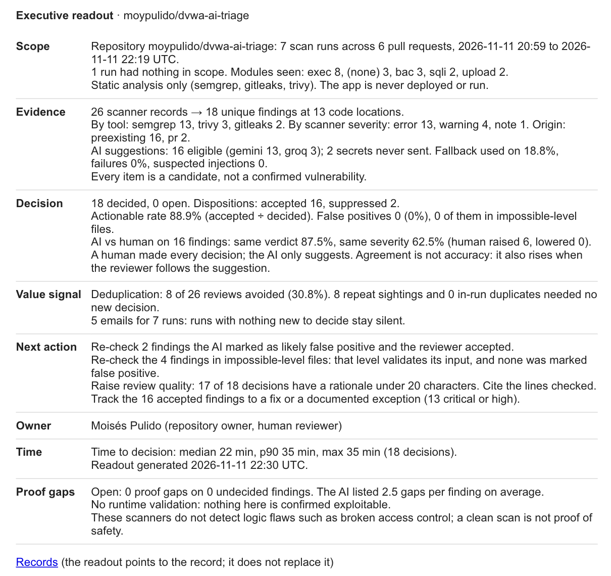
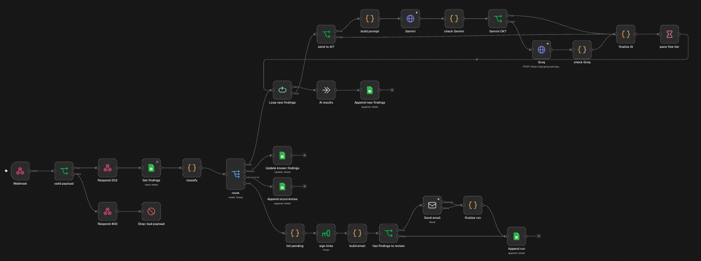
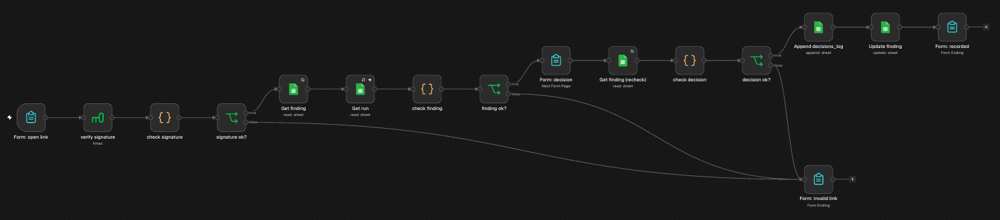
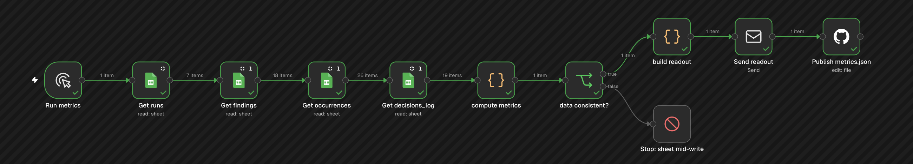

# dvwa-ai-triage

**English** | [Español](README.es.md)

> ⚠️ **THIS IS A DEMO.** This code is **intentionally vulnerable**.
> **It is never deployed**: not to production, not to staging, not to any
> internet-reachable server. It only runs locally, inside Docker, for
> educational purposes and to test AI-assisted vulnerability triage.

## Why this project

Many of the automated checks that run on pull requests look for known CVEs in
dependencies. The code the pull request itself introduces gets far less
attention: the developer is trusted. Supply-chain attacks such as the xz
backdoor (2024) showed that a change from a trusted contributor can be the attack.

This project puts the review on the change itself. Every pull request is
scanned, an AI gives a first opinion, and a person makes the final call, which
is recorded. It does not stop a determined attacker. It makes sure someone
looks, and that the decision leaves a trace.

I built it for my portfolio because cybersecurity is the field I enjoy most.

## What it does

**Scanners find, an AI suggests, a human decides, and every decision is recorded.**
It runs on pull requests against a trimmed copy of
[DVWA](https://github.com/digininja/DVWA), a web app that is vulnerable on
purpose, so there is always something real to triage. The analysis is static
only: every finding is a candidate, not a confirmed vulnerability.

The goal is to measure **decision quality, not alert volume**. The numbers are
public, as aggregates only: <https://moypulido.github.io/dvwa-ai-triage/>



## How it works



- **GitHub Actions**: [`scope-scan.yml`](.github/workflows/scope-scan.yml) scans only
  the changed files listed in [`.security/scope.txt`](.security/scope.txt), and
  [`normalize.py`](.github/scripts/normalize.py) merges the reports.
- **n8n**: three workflows (intake, decision, metrics). Sanitized exports and
  setup notes are in [`n8n/`](n8n/).

## What the reviewer sees

| Triage email (one per pull request) | Decision page |
|---|---|
|  |  |

The email shown is from an earlier test run. Its first finding has no suggestion
because both AI providers failed, so it reaches the reviewer as it is.

**Executive readout**: scope, evidence, decision, value signal, next action,
owner, time and proof gaps. Every sentence is derived from the numbers.



<details>
<summary>The three n8n workflows</summary>

**Flow 1 · intake**


**Flow 2 · decision** (form path; the manual helpers are not shown)


**Flow 3 · metrics**


</details>

## The scan target

A trimmed copy of DVWA, used as a controlled target.

<details>
<summary>What changed from the original</summary>

- **New repository, not a fork**: `digininja/DVWA` was cloned at upstream
  commit [`a1978a2`](https://github.com/digininja/DVWA/commit/a1978a2), its
  `.git` history was removed and the code was pushed as an independent
  repository.
- **Only 4 vulnerable modules** in `vulnerabilities/`:
  - `sqli` – SQL Injection
  - `exec` – Command Injection
  - `upload` – File Upload
  - `bac` – Broken Access Control

  All other modules (brute, csrf, fi, captcha, xss_*, csp, javascript, api,
  etc.) were removed. The shared helper files (`view_source.php`,
  `view_help.php`, `view_source_all.php`, `help.css`, `help.js`) are kept
  because the modules depend on them.
- **Menu adjusted**: `dvwa/includes/dvwaPage.inc.php` only lists the 4 kept
  modules (and enables `bac`, which was commented out in the original).
- **Dockerfile**: removed the `vulnerabilities/api` Composer install step, which
  no longer exists after trimming the modules and broke the build.
- **compose.yml**: set `pull_policy: build` and `image: dvwa-ai-triage:local`
  so the container is built from this trimmed source instead of pulling the
  official DVWA image (which ships every module). The published port stays
  bound to `127.0.0.1` only.
- **Removed**: translated READMEs, `CHANGELOG.md`, `SECURITY.md`,
  `security.txt`, `docs/`, `tests/`, the original `.github/` workflows and
  templates, and `external/` (only used by the removed `captcha` module).
- **Kept** (needed to run the app and the 4 modules):
  - `dvwa/` (core includes, CSS, JS, images)
  - `config/`, `database/`, `hackable/`
  - `vulnerabilities/` shared helpers: `view_source.php`, `view_help.php`,
    `view_source_all.php`, `help.css`, `help.js`
  - top-level pages: `index.php`, `login.php`, `logout.php`, `setup.php`,
    `security.php`, `instructions.php`, `about.php`, `phpinfo.php`
  - `Dockerfile`, `compose.yml`, `php.ini`, `COPYING.txt`, `favicon.ico`,
    `robots.txt`
- **Added**: the scan workflow, the scope file, the n8n workflows, the
  dashboard and this README.

</details>

### Running it locally

```bash
docker compose up -d
```

Open <http://localhost:4280>, log in with `admin` / `password` and click
**Create / Reset Database**. To stop it:

```bash
docker compose down
```

The port is bound to `127.0.0.1` only. Do not expose it.

## Credits and license

Based on **DVWA – Damn Vulnerable Web Application** by Robin Wood
([@digininja](https://github.com/digininja)) and contributors:
<https://github.com/digininja/DVWA>.

Like the original, this project is licensed under the
**GNU General Public License v3.0 (GPL-3.0)**. See [`COPYING.txt`](COPYING.txt).
